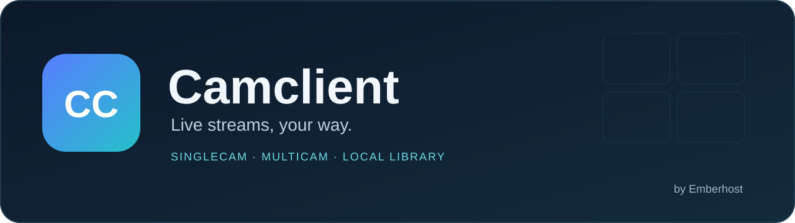

  

# Camclient

**SingleCam, MultiCam, model library and local statistics — one Tampermonkey script for Chaturbate.** Discover public live rooms, combine your favorite streams and organize your own collection directly in your browser.

**SingleCam, MultiCam, Modellbibliothek und lokale Statistiken — ein Tampermonkey-Skript für Chaturbate.** Öffentliche Live-Räume entdecken, Lieblingsstreams kombinieren und die eigene Sammlung direkt im Browser organisieren.

Developed by **Emberhost**. / Entwickelt von **Emberhost**.

| Area / Bereich | What you can do / Was du damit machen kannst |
| --- | --- |
| **Live & MultiCam** | Arrange streams in a grid or focus layout, drag models into slots, remove individual windows with × and control quality, sound and audio meters. / Streams im Raster oder Fokuslayout anordnen, Models in Fenster ziehen, einzelne Fenster mit × entfernen sowie Qualität, Ton und Pegelanzeigen steuern. |
| **SingleCam** | Watch one model with an adjustable player, zoom, chat, profile, notes and media gallery. / Ein Model mit anpassbarem Player, Zoom, Chat, Profil, Notizen und Mediengalerie ansehen. |
| **Discover & tags / Entdecken & Tags** | Browse live rooms, combine tags and use recommendations based on your local interests. / Live-Räume durchsuchen, Tags kombinieren und Empfehlungen anhand eigener lokaler Interessen nutzen. |
| **Model library / Modellbibliothek** | Organize favorites, groups, personal tags, notes, covers and saved media. / Favoriten, Gruppen, eigene Tags, Notizen, Cover und gespeicherte Medien verwalten. |
| **Statistics & following / Statistik & Gefolgt** | View locally observed watch time and activity, and the recognized account's following list. / Lokal beobachtete Sehzeit und Aktivität sowie die Gefolgt-Liste des erkannten Kontos ansehen. |
| **Design & data / Design & Daten** | Customize the interface, save workspaces and export or import your own backups. / Oberfläche anpassen, Arbeitsbereiche speichern und eigene Sicherungen exportieren oder importieren. |

<strong>Get started / Für den Einstieg:</strong> <a href="https://raw.githubusercontent.com/Emberhost92/Camclient/main/Camclient.user.js">Install or update Camclient / Camclient installieren oder aktualisieren</a> · <a href="#english">English guide</a> · <a href="#deutsch">Deutsche Anleitung</a> · <a href="https://github.com/Emberhost92/Camclient/issues/new/choose">Feedback</a>

**Version:** 20.113.0-custom · **License / Lizenz:** [MIT](LICENSE) · **Platform / Plattform:** Chaturbate · [Changes / Änderungen](CHANGELOG.md)

## Features / Funktionen

<strong>MultiCam & workspaces / MultiCam & Arbeitsbereiche</strong>

**English:** Watch several rooms together in a grid or focus layout. Drag a model from the sidebar into a target window, replace a stream or remove it from the current view with ×. Keep groups, favorites and saved workspaces. Adjust quality and audio independently and choose which audio meters are visible. Streams are prioritized over nonessential archive work; actual performance still depends on the number and quality of streams, your device and connection.

**Deutsch:** Mehrere Räume gemeinsam im Raster oder Fokuslayout ansehen. Ein Model aus der Seitenleiste in ein Fenster ziehen, einen Stream ersetzen oder mit × aus der aktuellen Ansicht entfernen. Gruppen, Favoriten und gespeicherte Arbeitsbereiche nutzen. Qualität und Ton getrennt einstellen und sichtbare Pegelanzeigen wählen. Streams haben Vorrang vor nachrangiger Archivarbeit; die tatsächliche Leistung hängt weiterhin von Anzahl und Qualität der Streams, Gerät und Verbindung ab.

<strong>SingleCam, screenshots & recordings / SingleCam, Screenshots & Aufnahmen</strong>

**English:** Adjust player size, zoom and sound, and show or hide the sidebar and tools. Open chat, public profile, notes, statistics and the model's media gallery. Explicit screenshots and completed recording segments are stored in the model's local gallery when storage succeeds. Browser downloads or directory access are separate features and depend on browser support and permissions. Use recording only where permitted and with the necessary rights.

**Deutsch:** Playergröße, Zoom und Ton einstellen sowie Seitenleiste und Werkzeuge ein- oder ausblenden. Chat, öffentliches Profil, Notizen, Statistik und die Mediengalerie des Models öffnen. Explizite Screenshots und fertiggestellte Aufnahmeabschnitte werden bei erfolgreicher Speicherung in der lokalen Modelgalerie abgelegt. Browserdownloads und Ordnerzugriff sind davon getrennt und hängen von Browserunterstützung und Berechtigungen ab. Aufnahmen nur mit den erforderlichen Rechten und soweit erlaubt verwenden.

<strong>Discovery, library & following / Entdecken, Bibliothek & Gefolgt</strong>

**English:** Search and filter the public room catalog, combine tags with AND, OR and exclusion, and find rooms matching your interests. Keep your own notes, tags, groups and covers. The following view uses the signed-in website account when it can be recognized; a stored snapshot can be older than the current live state. Local statistics describe activity observed by Camclient, not complete official account statistics.

**Deutsch:** Den öffentlichen Raumkatalog durchsuchen und filtern, Tags mit UND, ODER und Ausschluss kombinieren und passende Räume finden. Eigene Notizen, Tags, Gruppen und Cover behalten. Die Gefolgt-Ansicht nutzt das angemeldete Website-Konto, soweit es erkannt wird; ein gespeicherter Stand kann älter als der aktuelle Live-Zustand sein. Lokale Statistiken zeigen von Camclient beobachtete Aktivität und sind keine vollständige offizielle Kontostatistik.

<strong>Design, preferences & privacy / Design, Einstellungen & Datenschutz</strong>

**English:** Customize colors, fonts, backgrounds, layouts and previews. Search settings, favorite frequently used options and show changed values. Personal collections and media are kept in your browser rather than supplied with this download. Camclient uses browser storage, IndexedDB and Tampermonkey storage. Website data, live streams, public images and the externally loaded HLS library require network access. Your browser profile and its storage quota determine what can be retained; export backups regularly.

**Deutsch:** Farben, Schriften, Hintergründe, Layouts und Vorschauen anpassen. Einstellungen durchsuchen, häufig verwendete Optionen favorisieren und geänderte Werte anzeigen. Persönliche Sammlungen und Medien liegen im eigenen Browser und werden nicht mit diesem Download ausgeliefert. Camclient verwendet Browserspeicher, IndexedDB und Tampermonkey-Speicher. Website-Daten, Live-Streams, öffentliche Bilder und die extern geladene HLS-Bibliothek benötigen Netzwerkzugriff. Browserprofil und Speicherquote bestimmen, was erhalten bleiben kann; regelmäßig Sicherungen exportieren.

## English

<strong>Open installation guide: new installation and updates</strong>

### 1. Requirements

- A browser with [Tampermonkey](https://www.tampermonkey.net/). Local development checks used Brave; support for every browser and device has not been established.
- Access to Chaturbate and an internet connection for live content.
- Use only where you meet the website's age and access requirements. Camclient does not bypass login, age checks or access restrictions.

### 2. Install

1. Install Tampermonkey from its official website for your browser.
2. If Tampermonkey reports that userscripts are disabled, follow its [official setup instructions](https://www.tampermonkey.net/faq.php#Q209). Chrome-based browsers may require **Allow User Scripts** or Developer Mode.
3. Open **[Install Camclient](https://raw.githubusercontent.com/Emberhost92/Camclient/main/Camclient.user.js)** and review the Tampermonkey installation screen.
4. Confirm the script installation, then open or reload Chaturbate.
5. Open [Camclient Home](https://chaturbate.com/?multicam_discover=1&suite_view=dashboard) or [MultiCam](https://chaturbate.com/?multicam_mode=1).

**If you only see JavaScript:** Open Tampermonkey's dashboard, create a new script, replace the template with the complete contents of `Camclient.user.js` and save. Enable the script and reload the website. This is a userscript; do not paste it into the website console.

### 3. Update an existing installation

Export a backup of your settings and important media first. Open the install link again and update the existing Camclient entry. If using the editor, replace the contents of that existing script, save and reload the website. Do not create a second active copy. Keep the same browser profile and script identity. There is no separately configured automatic update feed in this version.

Updates use the existing stored data. Removing the script, clearing website or extension data, changing profiles or running out of storage may affect it; an update is not a substitute for a backup.

### 4. First steps

- **Home / Discover:** Choose a public room and open SingleCam or MultiCam.
- **MultiCam:** Drag models from the left list into windows; × removes a window from the current view.
- **SingleCam:** Adjust the player and open its tabs for chat, notes, profile and gallery.
- **Settings:** Search for an option or expand the relevant section.
- **Data & workspaces:** Save your layout and export a backup before major changes.

### 5. If something does not work

Confirm that Tampermonkey and Camclient are enabled, only one Camclient copy is active and the page was reloaded after saving. Check the displayed version under **About**. For buffering, test one stream first and check your connection and chosen quality. A private or offline room is not an available public stream. Send a report with the script version, browser, affected area and steps to reproduce; remove private information first.

## Deutsch

<strong>Installationsanleitung öffnen: Erstinstallation und Updates</strong>

### 1. Voraussetzungen

- Einen Browser mit [Tampermonkey](https://www.tampermonkey.net/). Die lokalen Entwicklungsprüfungen verwendeten Brave; eine Prüfung sämtlicher Browser und Geräte liegt nicht vor.
- Zugriff auf Chaturbate und Internet für Live-Inhalte.
- Nutzung nur, wenn du die Alters- und Zugangsvoraussetzungen der Website erfüllst. Camclient umgeht keine Anmeldung, Altersprüfung oder Zugriffsbeschränkung.

### 2. Installieren

1. Installiere Tampermonkey für deinen Browser über die offizielle Website.
2. Falls Tampermonkey deaktivierte Userscripts meldet, folge der [offiziellen Einrichtungshilfe](https://www.tampermonkey.net/faq.php#Q209). Chrome-basierte Browser können **Userscripts zulassen / Allow User Scripts** oder den Entwicklermodus verlangen.
3. Öffne **[Camclient installieren](https://raw.githubusercontent.com/Emberhost92/Camclient/main/Camclient.user.js)** und prüfe die angezeigte Tampermonkey-Installationsseite.
4. Bestätige die Skriptinstallation und öffne oder lade Chaturbate neu.
5. Öffne die [Camclient-Startseite](https://chaturbate.com/?multicam_discover=1&suite_view=dashboard) oder [MultiCam](https://chaturbate.com/?multicam_mode=1).

**Du siehst nur JavaScript?** Öffne das Tampermonkey-Dashboard, erstelle ein neues Skript, ersetze die Vorlage durch den vollständigen Inhalt von `Camclient.user.js` und speichere. Aktiviere das Skript und lade die Website neu. Es handelt sich um ein Userscript; den Code nicht in die Website-Konsole einfügen.

### 3. Bestehende Installation aktualisieren

Exportiere zuerst eine Sicherung deiner Einstellungen und wichtiger Medien. Öffne den Installationslink erneut und aktualisiere den vorhandenen Camclient-Eintrag. Bei Verwendung des Editors ersetzt du den Inhalt dieses bestehenden Skripts, speicherst und lädst die Website neu. Keine zweite aktive Kopie anlegen. Dasselbe Browserprofil und dieselbe Skriptidentität beibehalten. Diese Version enthält keinen separat eingerichteten automatischen Updatekanal.

Updates verwenden die vorhandenen gespeicherten Daten. Skriptentfernung, Löschen von Website- oder Erweiterungsdaten, Profilwechsel und fehlender Speicherplatz können sie beeinträchtigen; ein Update ersetzt keine Sicherung.

### 4. Erste Schritte

- **Start / Entdecken:** Einen öffentlichen Raum auswählen und in SingleCam oder MultiCam öffnen.
- **MultiCam:** Models aus der linken Liste in Fenster ziehen; × entfernt ein Fenster aus der aktuellen Ansicht.
- **SingleCam:** Player einstellen und Chat, Notizen, Profil oder Galerie über die Reiter öffnen.
- **Einstellungen:** Nach einer Option suchen oder den passenden Bereich aufklappen.
- **Daten & Arbeitsbereiche:** Layout speichern und vor größeren Änderungen eine Sicherung exportieren.

### 5. Wenn etwas nicht funktioniert

Prüfe, ob Tampermonkey und Camclient aktiviert sind, nur eine Camclient-Kopie läuft und die Seite nach dem Speichern neu geladen wurde. Unter **Über** steht die angezeigte Version. Bei Nachladen zunächst einen Stream testen und Verbindung sowie gewählte Qualität prüfen. Ein privater oder offline geschalteter Raum ist kein verfügbarer öffentlicher Stream. Für eine Fehlermeldung Skriptversion, Browser, betroffenen Bereich und Schritte zum Nachstellen angeben; persönliche Informationen vorher entfernen.

## Downloads & changes / Downloads & Änderungen

| File / Datei | Purpose / Zweck |
| --- | --- |
| **[Camclient.user.js](https://raw.githubusercontent.com/Emberhost92/Camclient/main/Camclient.user.js)** | Complete installable userscript / Vollständiges installierbares Userscript |
| [CHANGELOG.md](CHANGELOG.md) | Recent changes / Letzte Änderungen |
| [SHA256SUMS](SHA256SUMS) | Download checksum / Download-Prüfsumme |
| [THIRD_PARTY_NOTICES.md](THIRD_PARTY_NOTICES.md) | Attribution and third-party notices / Urheber- und Drittanbieterhinweise |

The JavaScript file is also the distributed source. This repository package contains the clean installable build and public documentation, not personal browser exports. / Die JavaScript-Datei ist zugleich der ausgelieferte Quellcode. Dieses Paket enthält den sauberen installierbaren Build und öffentliche Dokumentation, keine persönlichen Browserexporte.

## Feedback & support / Feedback & Unterstützung

Use [GitHub Issues](https://github.com/Emberhost92/Camclient/issues/new/choose) for bugs and feature requests. Public reports must not contain passwords, session cookies, API keys or personal backups. / Nutze [GitHub Issues](https://github.com/Emberhost92/Camclient/issues/new/choose) für Fehler und Wünsche. Öffentliche Meldungen dürfen keine Passwörter, Sitzungscookies, API-Schlüssel oder persönlichen Sicherungen enthalten.

**[Adult Client](https://github.com/Emberhost92/AdultClient)** is Emberhost's separate Windows application. / **[Adult Client](https://github.com/Emberhost92/AdultClient)** ist Emberhosts eigenständige Windows-Anwendung.

Camclient is released under the [MIT license](LICENSE). Legacy copyright notices are retained in the script and [third-party notices](THIRD_PARTY_NOTICES.md). / Camclient steht unter der [MIT-Lizenz](LICENSE). Übernommene Copyright-Hinweise bleiben im Skript und den [Drittanbieterhinweisen](THIRD_PARTY_NOTICES.md) erhalten.
